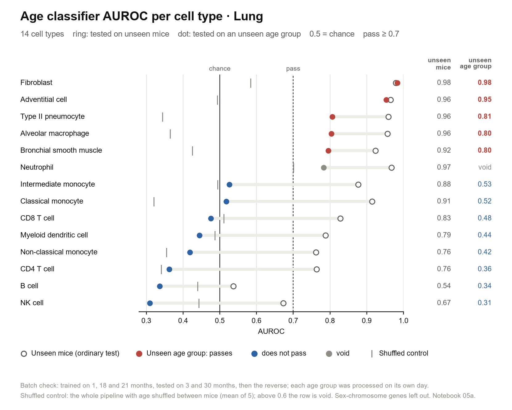
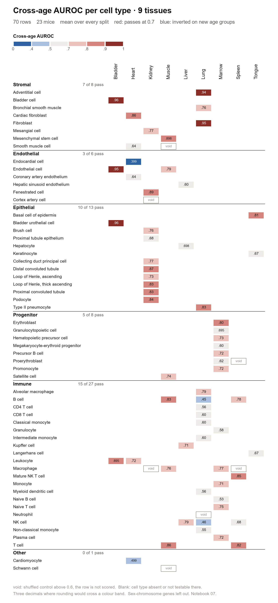
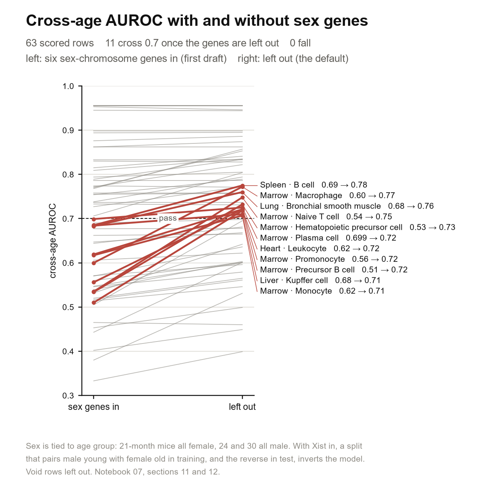
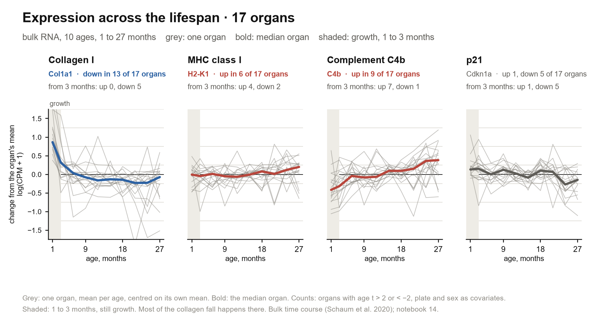
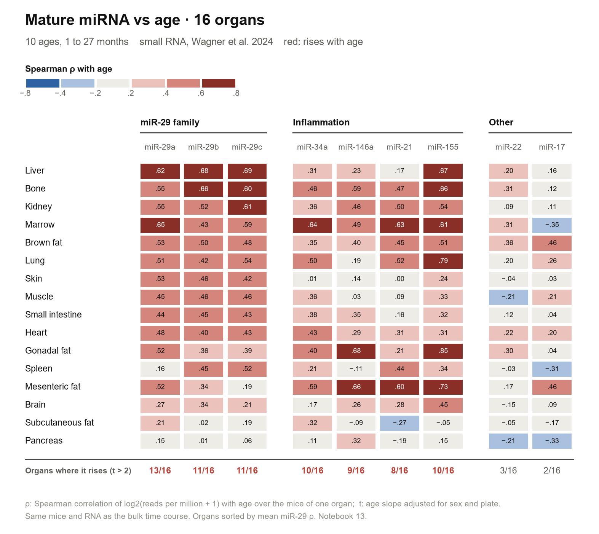

# Mouse Single-Cell Aging

Which cell type in an aging mouse tissue truly changes with age, once the
batch it was processed in is accounted for?

The pipeline trains one age model per cell type with whole mice held out, then
tests every model a second time on an age group it never saw. In this atlas
each age group was processed on its own day, so only the second test separates
aging from batch. The pipeline then names the gene behind each model, estimates
age in month, and checks what it finds against a second lab and a 10-age bulk
time course. It runs on any annotated atlas with age and mouse identity; here,
on every testable droplet tissue of Tabula Muris Senis.

**Result in brief.**

- Of 70 tissue × cell type row in 9 tissue, **40 keep an age signal** on an age
  group the model never saw.
- An ordinary held-out score is **not evidence of aging** in this atlas: in the
  lung 12 of 14 cell type score well on unseen mice, and 7 of those 12 fail on
  an unseen age group.
- What replicates in a second lab and in a bulk time course is small and
  consistent: **complement and MHC class I rise**. Collagen falls too, but
  mostly while the mice are still growing (1 to 3 month).
- Two first-draft claim did not survive review: that structural cell pass the
  batch check more often than immune cell (mostly a sex-chromosome-gene
  artifact; a small edge of 0.1 AUROC remains), and the p21 rise (not replicated).



*Each lung cell type scored two way. The ring (tested on mice never seen) is
high almost everywhere; the dot (tested on an age group never seen) falls to
chance for every lymphocyte and monocyte. The gap between them is the batch
effect this project is built to detect.*


## Contents

1. [Overview](#1-overview)
2. [Biological Background](#2-biological-background)
3. [Method](#3-method)
4. [Result](#4-result)
5. [Critical Review And Limitation](#5-critical-review-and-limitation)
6. [Software](#6-software)
7. [Reference](#7-reference)


## 1. Overview

### 1.1 Term Used Throughout

| Term | Meaning |
| --- | --- |
| Row | One cell type in one tissue, such as lung fibroblast. The atlas has 70 |
| AUROC | Chance that a random old cell scores above a random young one: 0.5 is chance, 1 is perfect, below 0.5 the model is inverted |
| Ordinary test | Train on some mice, test on mice never seen. Its number: **AUROC on unseen mice** |
| Batch check | Train on some age group, test on age group never seen, so a model cannot win by recognizing a processing day. Its number: **cross-age AUROC**; a row **passes** at ≥ 0.7 |
| Shuffled control | The whole pipeline rerun with age shuffled between mice. It should stay near 0.5; above 0.6 the row is **void** |
| Verdict | **Age signal** (passes, control fine), **partial** (cross-age 0.5–0.7), **batch driven** (below 0.5), **void** |
| Technically confounded | A model given only technical feature (depth, ribosomal and blood fraction) also passes the batch check |
| Robust row | An age-signal row that is not technically confounded: the row every later analysis uses |
| Structural cell | Stromal, endothelial and epithelial cell, as against immune cell |
| Second lab | Kimmel et al. 2019: lung, kidney and spleen of other mice, processed in another laboratory |
| Bulk time course | Whole-organ RNA from the same consortium: 17 organ, 10 age from 1 to 27 month |

### 1.2 How The Project Got Here

Each step answered what the step before it showed.

| # | What was seen | So the next step was | What that showed | Section |
| --- | --- | --- | --- | --- |
| 1 | A per-cell-type model tells old from young lung cell almost perfectly on unseen mice | Ask whether that is aging or batch: every age group was processed on its own day | The ordinary test cannot tell them apart | 2.3 |
| 2 | Age and processing batch are the same grouping | Test on age group never seen (**batch check**) | Only 5 of 14 lung cell type keep their score | 3.2, 4.12 |
| 3 | Neutrophil scored 0.97, suspiciously high | Rerun with age shuffled between mice (**shuffled control**) | The pipeline reaches 0.70 on noise there; the row is void | 3.2 |
| 4 | Gene list of passing model held lung-epithelium gene inside immune cell | Fit an ambient-RNA filter per tissue, check it on known case | Free-floating RNA removed, real gene such as p21 kept | 3.2 |
| 5 | Lung stroma passed, lung immune cell failed: a quirk or a rule? | Fix the rule in advance, run every testable tissue | 9 tissue, 70 row; 40 pass | 4.1, 4.2 |
| 6 | A batch shared by all young against all old mice would still pass | Give a model only technical feature | 8 row technically confounded, flagged not hidden | 4.3 |
| 7 | Row of one tissue share mice, so they are not independent | Compare structural and immune row **within** tissue | Structural score 0.1 higher, but do not pass more often | 4.2 |
| 8 | Sex is tied to age group (21-month mice all female, 24 and 30 all male) | Test sex alone, male mice alone, and model without sex-chromosome gene | *Xist* inverted the check: 11 row rise once it is out, none falls; now the default | 4.3 |
| 9 | Every check so far lives inside one atlas | Test in a second lab and a 10-age bulk time course | MHC class I and complement up replicate; collagen falls mostly during growth; p21 does not | 4.6, 4.7 |
| 10 | Cell-level statistic count each cell as a sample | Sum cell per mouse, test with the mouse as sample | A small shared core: MHC class I in 30 of 30 robust row | 4.5 |
| 11 | Maybe a linear model is too weak | Five classifier and five clock, scored only on batch-proof test | Nothing beats logistic regression; an ordinal clock helps a little | 4.8 |
| 12 | Collagen falls, and miR-29 represses collagen | Infer miR-29 from its target, then measure it in the same mice | miR-29 does rise, but the inference only follows age | 4.10 |
| 13 | Age can be treated as time | Fit dynamical model: acceleration, thymic involution, forecasting | With 4–10 age and 23 mice, most question cannot be answered | 4.11 |
| 14 | The limit at every step is the design, not the model | Move to data where age is not tied to batch | Continues with human blood in a successor repository | 5.3 |

### 1.3 What Holds Up

| Finding | Evidence | Strength |
| --- | --- | --- |
| An ordinary AUROC on unseen mice **cannot** be read as aging here | Lung: 12 of 14 cell type reach 0.7 on unseen mice, 6 keep it on unseen age group (one void); perfect per-mouse ranking with chance-level transfer | **strong**, the methodological result |
| MHC class I and complement rise with age | Pseudobulk in 30 of 30 robust row (*H2-D1*; *H2-K1*, *B2m* 29 of 30); second lab (*C3*, *Cfb*); bulk, from 3 month on (*C4b* 7 organ, MHC-I 4–6) | **strong**: three independent design |
| Collagen falls with age | Steep during growth (1 → 3 month) in nearly every organ; from 3 month on, bulk *Col1a1* / *Col3a1* down in 5 / 7 of 17 organ, lung stroma per cell keeps falling, the second lab is mixed | **moderate** for aging; downgraded from "most universal" |
| Sex, not batch, explained much of the immune "failure" outside lung | Without six sex-chromosome gene 11 row rise to an age signal, none falls; immune pass rate 0.30 → 0.56 | **new**, from the critical review |
| Structural cell carry a slightly more transferable age signal than immune cell of the same organ | Within tissue, cross-age 0.10 higher (permutation p = 0.013; 0.11, p = 0.002 without technically confounded row); pass rate **not** higher (0.74 vs 0.56, p = 0.28); without lung, immune passes more often | **weak to moderate**, downgraded twice |
| A weak age direction transfers to a second lab | 19 of 19 matched row rank old above young (0.51–0.76); technical feature alone also transfer in 12 of 19; expression clearly beats them in 10 | **moderate** for those 10; **unresolved** for lymphocyte |
| p21 (*Cdkn1a*) rises in old structural cell | 16 of 17 robust structural row inside this atlas; **not** in the second lab, **not** in bulk | **not replicated** |
| Aging looks like steady drift, not acceleration | Linear beats a saturating-removal model for p16 in 10 of 11 organ, but p16 sits near detection floor | **weak**: acceleration not testable |

Section 4.1–4.7 are confirmatory (rule fixed before the data were seen);
4.8–4.11 are exploratory and are never used to support a claim above.


## 2. Biological Background

### 2.1 Why Per Cell Type

Bulk RNA-seq averages a whole organ, so a rising inflammation gene could mean
every cell turned it up or a few immune cell moved in: opposite biology, same
readout. Single-cell RNA-seq asks each cell type separately. Per-cell-type age
model are an active direction (Buckley et al. 2023, mouse brain). The atlas's
own aging analysis (Zhang et al. 2021) tested cell rather than mouse and had no
batch control, the gap this project closes.

### 2.2 What Droplet Data Get Wrong

Tissue is digested at 37 °C, each cell is caught in an oil droplet with a
barcoded bead, and the 3′ end of its polyadenylated mRNA is counted per gene.

| Property | What it is | Consequence here |
| --- | --- | --- |
| **Sparsity** | Over 90% of entry are zero; a cell gives up only part of its mRNA | A zero usually means "not caught"; p16 is seen in 0.8% of cell and must be summed per mouse |
| **Depth** | Cell differ in how many molecule were caught | Normalized per cell; depth itself serves as a technical control |
| **Ambient RNA** | Burst cell release RNA that lands in every droplet | A fibroblast gene can appear "inside" a T cell; filtered per cell type (3.2) |
| **Dissociation stress** | Digestion switches on *Fos*, *Jun*, *Hspa1a* within minute | Handling time looks like biology; these gene are flagged, never read as aging |

Doublet (two cell in one droplet) are removed, and mature microRNA are not
captured at all.

### 2.3 The Dataset And The Design Problem

**Tabula Muris Senis** (Tabula Muris Consortium 2020) profiled C57BL/6 mice at
1, 3, 18, 21, 24 and 30 month. The droplet part covers 16 tissue but only **23
mice**, because one mouse gave cell to up to 12 organ.

**Age is confounded with batch and sex.** Each age group was collected and
processed at its own time, so anything that differed between processing day
(reagent lot, sequencing run, time of day, handling) also differs between age
group. Sex is tied to age group as well: the 21-month mice are all female, the
24- and 30-month mice all male. No statistical correction can remove this,
because no young and old mouse were processed together. It can only be **tested
around**: by testing on age group never seen (3.2), by showing that technical
feature or sex alone cannot do the same job (4.3), and by checking result in
data of a different design:

| Dataset | Design | Role |
| --- | --- | --- |
| Kimmel et al. 2019 | Second lab; lung, kidney, spleen; 3–4 young (7–8 month) and 3 old (~21 month) male mice | A model that transfers here cannot be reading TMS batch |
| Bulk time course (Schaum et al. 2020) | 17 organ, 56 mice, **10 age** from 1 to 27 month; plate balanced across age | Fills the 3–18 month gap; plate is a covariate, not a confounder |
| Small RNA (Wagner et al. 2024) | The same bulk mice and RNA extract; 771 sample, 16 organ | Measures the mature miRNA that 4.10 otherwise infers |

### 2.4 The Aging Biology Touched Here

Aging is organized into **hallmark**: process that change with age, speed aging
when worsened and slow it when fixed (López-Otín et al. 2023).

| Process | What it is | Marker used here |
| --- | --- | --- |
| **Cellular senescence** | A stressed cell stops dividing for good and secretes an inflammatory mix (SASP); clearing such cell extends healthy lifespan in mice (Baker et al. 2011) | p16 (*Cdkn2a*), the specific marker; p21 (*Cdkn1a*), which also rises after any stress, so alone it is not proof (Hernandez-Segura et al. 2018); the SenMayo set (Saul et al. 2022) |
| **Inflammaging** | Chronic low-grade inflammation without infection (Franceschi et al. 2000) | NF-κB and interferon (IRF1, STAT1) activity; **MHC class I** (*H2-K1*, *H2-D1*, *B2m*), which shows a cell's protein to CD8 T cell; **complement** (*C3*, *C4b*, *Cfb*), which tags debris for clearance |
| **Matrix loss** | Fibroblast make less of the collagen scaffold (*Col1a1*, *Col3a1*) | Collagen and matrix gene |
| **Thymic involution** | The thymus shrinks from early adulthood, so naive T cell (*Sell*, *Ccr7*, *Lef1*, *Tcf7*) give way to memory cell (*Cd44*, *S100a4*, *Ccl5*) (Palmer 2013) | Naive and memory T-cell score |
| **MicroRNA** | A ~22-nucleotide RNA that speeds the decay of hundred of target mRNA; **miR-29** represses collagen and rises with age (Ugalde et al. 2011) | Target set falling together; measured mature miRNA |
| **Ageotype** | Whether the organ of one individual look old together (Ahadi et al. 2020) | Per-organ clock residual |


## 3. Method

### 3.1 Statistical Principle

- **The mouse is the sample.** Cell of one mouse share genotype, health,
  processing day and sex, so 10,000 cell from 12 mice are 12 sample. Treating
  cell as sample (pseudoreplication; Hurlbert 1984) makes every p-value tiny and
  wrong, the most common error in single-cell aging study (Squair et al. 2021).
- **Grouped cross-validation.** All cell of a mouse sit in training or in
  testing, never both; otherwise the model recognizes the mouse and inherits its
  label.
- **Permutation null.** Age is shuffled **between mice**, never between cell. A
  shuffle can be restricted (within a tissue) to keep structure a plain test
  would ignore.
- **Multiple testing.** Benjamini–Hochberg controls the false discovery rate.
- **Regularization.** With 2,000 gene and a dozen mice, L2 (logistic $C = 0.1$,
  ridge $\alpha$ = 10–1000) keeps weight small.
- **Pseudobulk.** Count summed per mouse and cell type, tested with DESeq2
  (Love et al. 2014).
- **Bootstrap interval.** Test mice resampled 1,000 time; the middle 90% of the
  score is reported.
- **Confirmatory vs exploratory.** Confirmatory analysis had its rule fixed
  before seeing the data; exploratory analysis searched, and its p-value are
  optimistic.

### 3.2 Pipeline

Notation: cell $i$ of mouse $d(i)$ with age $a(d)$ in month; cell type $c$ gives
the cell subset $I_c$.

**Step 1: rebuild, QC, normalize.** Count are rebuilt from `.raw` and asserted
integer, because the released `.X` is already log-normalized and normalizing
twice is silent. Scrublet (Wolock et al. 2019) calls doublet **per mouse** on
count (run on a normalized matrix it flagged 127 lung cell instead of 49). Count
per 10,000 then $\log(1+x)$, 2,000 variable gene, PCA, Leiden and UMAP; cluster
check the provided label, never replace it.

**Step 2: composition first.** The fraction of each cell type per mouse,
$f_{d,c}$, is tested against age (Spearman, BH) separately, because a cell type
can change in number with no cell changing inside it.

**Step 3: one matrix per cell type.** At most 300 cell per mouse (one lung mouse
holds a third of all cell); label $y_i = \mathbb{1}[a(d(i)) \in \text{OLD}]$; at
least 50 cell and 2 mice in each class. Feature: the 2,000 variable gene **minus
the six sex-chromosome gene** (`SEX_PATTERN`), because sex is tied to age group
and *Xist* can invert a model on a new age group (4.3).

**Step 4: score.** L2 logistic regression ($C = 0.1$) with
`StratifiedGroupKFold` over mice; each cell is scored by a model that never saw
its mouse. AUROC over cell and over mouse (each mouse's mean score); LightGBM as
a comparison.

**Step 5: the two gate.**

- *Shuffled control.* Age permuted between mice, $\tilde{y}_i =
  \mathbb{1}[\pi(d(i)) \in \text{OLD}]$, mean of five permutation. It is a floor,
  not a p-value: fibroblast 0.98 against 0.60 clears it; neutrophil 0.97 against
  0.70 is void.
- *Batch check.* Train on one young age and a non-empty proper subset $S$ of the
  old age, test on the rest:
  $\lbrace y_1 \rbrace \cup S \to \lbrace y_2 \rbrace \cup (\text{OLD} \setminus S)$,
  for every $y_1$ and $S$ (twelve split in lung). `cross_age_all_splits`
  averages them; ≥ 0.7 passes. Lung also keeps its first hand-picked split,
  1m + 18m + 21m ↔ 3m + 30m. A 90% interval resamples test mice.
- *What the gate cannot see.* A batch shared by every young against every old
  age, and a sex difference aligned with age in every split: the technical-only
  and sex-only control (4.3) cover those. Failing the gate means "not
  demonstrable with this design", not "no aging".

**Step 6: filter the gene, then read them.** Only a model with AUROC ≥ 0.8 and
a passing batch check is read. Filter level: `hvg` (all variable gene),
`clean` (minus sex-chromosome and ambient gene), `bio` (minus ribosomal, rRNA,
*Malat1*, hemoglobin), `own` (minus other cell type's marker). Gene $g$ is
foreign to cell type $c$ when

$$\max_{c' \neq c} \mu_{c',g} > 1 \quad \text{and} \quad \frac{m_{c,g}}{\max_{c' \neq c} m_{c',g}} < \tau,$$

with $\mu$ the mean log and $m$ the mean linear expression. Ambient RNA is a
near-constant fraction of the soup, so the log-ratio splits into two group
(ambient ~0.004, real ~0.12), and a two-component Gaussian mixture fits $\tau$
per tissue (lung 0.031). Checked on six case it was not fit on:

| Gene in cell type | Ratio | Want | Result |
| --- | --- | --- | --- |
| *Sftpc* in neutrophil | 0.0016 | drop | dropped |
| *Sftpc* in bronchial smooth muscle | 0.0015 | drop | dropped |
| *Mgp* in alveolar macrophage | 0.0083 | drop | dropped |
| *Scgb1a1* in CD8 T cell | 0.0044 | drop | dropped |
| *Cdkn1a* in fibroblast | 0.068 | keep | kept |
| *Cd74* in alveolar macrophage | 0.037 | keep | kept, the closest call |

Two alternative were tried and rejected: fraction of cell expressing (ambient
*Sftpc* is in 66% of neutrophil, real *Cdkn1a* in 16% of fibroblast) and
within-mouse soup tracking (depth moves every gene together). Circadian (*Dbp*,
*Nr1d1*) and dissociation gene are **flagged, not dropped**: they reveal when
and how the mice were collected.

**Step 7: development against aging.** From per-mouse mean,
$\Delta_{\text{dev}} = \mu_{3\text{m}} - \mu_{1\text{m}}$ and
$\Delta_{\text{age}} = \operatorname{mean}_{\text{OLD}} \mu - \mu_{3\text{m}}$.
**Aging only** when $|\Delta_{\text{age}}| > 0.5$ and $|\Delta_{\text{dev}}| < 0.2$;
the cutoff only sort gene for reading.

**Step 8: the clock.** Ridge regression on age in month, adult mice only,
leave one mouse out, per-mouse median prediction. Error is judged against a
naive baseline that guesses the mean age of the other mice, at all three
$\alpha$. Holding out a whole age group asks whether the clock orders an age it
never saw.

**Step 9: across tissue.**

| Analysis | Method | Notebook |
| --- | --- | --- |
| Survey | Mice, age, sex and cell per tissue from metadata; testability rule fixed | 06 |
| Atlas | Verdict per row; technical-only, sex-only, male-only and dominant-mouse rerun; interval over test mice; within-tissue permutation | 07 |
| Senescence | SenMayo, p21 and p16 per mouse; Spearman with age, stable if the sign holds with any age group left out | 08 |
| Pseudobulk | DESeq2 old vs young; row agreement against a null that permutes the 23 mice's label once for every tissue | 09 |
| Replication | TMS model scored on Kimmel unchanged; technical-only transfer | 10 |
| Model comparison | Five classifier, five clock | 11 |
| Regulator | Transcription factor, pathway and hallmark activity (decoupler) | 12 |
| miRNA | Target-set activity; measured mature miRNA | 13 |
| Bulk | Age effect with plate and sex as covariate; MOFA+; per-organ clock | 14 |
| Dynamics | ODE, SDE, forecasting, optimal transport | 16 |

### 3.3 Rule And Threshold

Every threshold was set on the lung, the development tissue, then written down
in `06_survey` before any other tissue was modelled.

| Stage | Rule |
| --- | --- |
| Classifiable | ≥ 2 young and ≥ 2 old mice, ≥ 50 cell per class |
| Batch-testable | also ≥ 2 distinct young and ≥ 2 distinct old age |
| Age signal | cross-age (all split) ≥ 0.7 and shuffled ≤ 0.6 |
| Partial / batch driven / void | cross-age 0.5–0.7 / below 0.5 / shuffled > 0.6 |
| Technically confounded | the technical-only model also reaches 0.7; reported, not deleted |
| Gene read | AUROC ≥ 0.8, a passing batch check, the `own` filter |

**Planned and added check.** The survey and verdict rule, the pseudobulk, the
replication and the bulk test were planned before their data were seen. The
technical-only control was added after bladder looked uniformly perfect, the
dominant-mouse rerun after the outlier flag, and the within-tissue permutation,
interval, sex control and technical transfer test during the critical review.
Each added check could only remove or downgrade a claim, with one exception:
leaving the sex-chromosome gene out turned 11 partial row into age signal. It
was adopted for a stated mechanism after its effect was seen, and both version
are reported (5.1, objection 23).

### 3.4 Learning Method

Every setting is fixed in code before its result is seen; where one changed
after a smoke test, the notebook says so. No model is ranked on the ordinary
test alone.

| Group | Method | Notebook | Role |
| --- | --- | --- | --- |
| Unsupervised | PCA; kNN graph, Leiden, UMAP; Scrublet | 03, 14, 16 | Structure, label check, doublet |
| | Two-component Gaussian mixture | 05b | Ambient cutoff per tissue |
| | MOFA+ (Argelaguet et al. 2020) | 14 | Factor shared across 17 organ of one mouse |
| Classification | L2 logistic regression | 05a, 07, 10, 11 | The main model |
| | LightGBM (Ke et al. 2017); elastic net (Zou and Hastie 2005); mouse-level logistic; attention MIL (Ilse et al. 2018) | 05a, 11 | Challenger |
| | Logistic regression on technical feature or sex only | 07, 10 | Control |
| Regression | Ridge | 05c, 10, 14 | The clock |
| | Ordinal regression (Frank and Hall 2001); kernel ridge; LightGBM; MLP | 11 | Challenger clock |
| Mouse-level statistic | PyDESeq2 (Muzellec et al. 2023); OLS with covariate; decoupler linear model (Badia-i-Mompel et al. 2022); gene-set score; rank test; permutation; bootstrap | 07–14 | Test with the mouse as sample |
| Dynamical (exploratory) | Saturating-removal ODE/SDE (Karin et al. 2019); naive-fraction ODE with profile likelihood; spline, sigmoid, linear ODE; SINDy; neural ODE; optimal transport (`moscot`) | 16 | Age as time (3.5) |

### 3.5 Dynamical-System Idea

Age is treated as time and a state $x$ follows $\dot{x} = f(x, t)$.

- **Loss of steady state.** In Karin et al. 2019, senescent cell are produced at
  a rate $\eta t$ and removed at a saturating rate $\beta X/(\kappa + X)$. Once
  production passes $\beta$ no balance exists and the burden accelerates, which
  they link to the Gompertz rise of mortality.
- **Early-warning signal.** Near a tipping point a system recovers slowly, so
  variance and correlation rise (Scheffer et al. 2009); this is defined for one
  system observed repeatedly.
- **Identifiability.** A flat profile likelihood means very different parameter
  value fit equally well (Raue et al. 2009).
- **Learning an equation.** SINDy (Brunton et al. 2016) and neural ODE (Chen et
  al. 2018) both need many time point per parameter.
- **Optimal transport.** Couples the cell of two age and predicts the population
  in between (Schiebinger et al. 2019); a held-out middle age tests it.


## 4. Result

| Section | Status | One-line answer |
| --- | --- | --- |
| [4.1](#41-which-tissue-can-be-tested) Survey | confirmatory | 9 of 16 tissue testable; 23 mice in all |
| [4.2](#42-age-signal-across-tissue) Atlas | confirmatory | 40 of 70 row pass; structural row 0.1 higher within tissue, but not more often passing |
| [4.3](#43-check-behind-the-atlas) Check | confirmatory | technical batch in bladder; sex-chromosome gene hid immune signal; every pass has an interval above 0.5 |
| [4.4](#44-senescence) Senescence | confirmatory | SenMayo flat; p21 rises inside this atlas only |
| [4.5](#45-gene-with-the-mouse-as-sample) Pseudobulk | confirmatory | a small shared core: MHC class I, interferon, complement |
| [4.6](#46-replication-in-a-second-lab) Second lab | confirmatory | weak direction transfers; complement replicates, p21 does not |
| [4.7](#47-bulk-time-course) Bulk | confirmatory | complement and MHC-I up; collagen falls mostly during growth; p21 flat |
| [4.8](#48-which-model-generalizes) Model | exploratory | nothing beats logistic regression; ordinal clock helps |
| [4.9](#49-regulator) Regulator | exploratory | co-varies with interferon / NF-κB; not circular, not ambient |
| [4.10](#410-microrna) miRNA | exploratory | measured miR-29 rises in 11–13 of 16 organ; target-gene inference follows only age |
| [4.11](#411-dynamics) Dynamics | exploratory | steady drift; most model question not answerable here |
| [4.12](#412-lung-worked-example) Lung | worked example | every step on one tissue |

### 4.1 Which Tissue Can Be Tested

The batch check needs two young and two old age with enough cell, so
testability is a property of the design, decided from metadata alone
(`06_survey`).

| Tissue | Young / old mice | Batch-testable cell type | Read as |
| --- | --- | --- | --- |
| Lung | 6 / 10 | 14 | tested |
| Marrow | 4 / 13 | 14 | tested |
| Kidney | 5 / 11 | 12 | tested |
| Limb muscle | 4 / 12 | 8 | tested |
| Heart and aorta | 2 / 9 | 6 | tested, thin: one 1m and one 3m mouse |
| Spleen | 3 / 10 | 6 | tested |
| Bladder | 4 / 4 | 4 | tested, technically confounded (4.3) |
| Liver | 5 / 7 | 4 | tested |
| Tongue | 5 / 4 | 3 | tested |
| Mammary gland | 2 / 4 | 0 | not testable: every young mouse is 3m |
| Thymus | 1 / 5 | 0 | not testable: one young mouse |
| Trachea | 2 / 0 | 0 | not testable: no old mouse |
| Fat, pancreas, skin, large intestine | 0 / 3–8 | 0 | not testable: no young mouse |

The median mouse gave 7 tissue and one gave 12, so tissue are not independent
replicate.

### 4.2 Age Signal Across Tissue

Verdict over the 70 row: **40 age signal, 19 partial, 4 batch driven, 7 void**
(with the sex-chromosome gene in, before the review: 29, 28, 6, 7).



*Every row, grouped by compartment, each with its pass count. Red passes the
batch check, grey is 0.5–0.7, blue means the model is inverted on new age
group; void cell are outlined. Immune row pass in limb muscle, spleen, marrow
and liver; the pale immune column is the lung.*

| Compartment | Row | Age signal | Rate | Without technical row | Median cross-age |
| --- | --- | --- | --- | --- | --- |
| Stromal | 8 | 7 | 0.88 | 5 of 6, 0.83 | 0.88 |
| Epithelial | 13 | 10 | 0.77 | 9 of 11, 0.82 | 0.80 |
| Endothelial | 6 | 3 | 0.50 | 3 of 4, 0.75 | 0.71 |
| Immune | 27 | 15 | 0.56 | 15 of 26, 0.58 | 0.71 |
| Progenitor | 8 | 5 | 0.62 | 4 of 7, 0.57 | 0.72 |

**Structural against immune, within tissue.** Row of one tissue share mice, and
marrow and spleen contribute only immune row, so a test over row is replaced by
a comparison inside each tissue (`07` §10):

| Test (without technically confounded row) | Structural − immune | p | Read as |
| --- | --- | --- | --- |
| Row as independent sample (Fisher; Mann–Whitney) | pass rate 0.81 vs 0.58 | 0.12; 0.005 | **superseded**: overstates independence |
| Within-tissue permutation, pass rate | +0.23 | 0.20 | **not significant** |
| Within-tissue permutation, mean cross-age | +0.11 | 0.002 | **holds** |
| Tissue fixed effect, adjusted for cell and mouse count | +0.15 | 0.001 | holds; cell count (p 0.94) and mouse count (p 0.16) do not explain it |
| Tissue with both kind where structural is higher | 4 of 6 | sign test 0.34 | not decisive |
| With the sex-chromosome gene put back (pre-review) | pass rate 0.76 vs 0.31; cross-age +0.15 | 0.10; 0.001 | the first draft's gap was mostly sex |
| All row, technically confounded included | pass rate 0.74 vs 0.56; cross-age +0.10 | 0.28; 0.013 | same picture |

**Read as:** structural cell keep a slightly more transferable age signal than
the immune cell of the same mice, about 0.1 AUROC, but do not pass more often.
The lung (structural 0.87 against immune 0.58) carries what is left of the gap;
without it the immune pass rate (0.78) exceeds the structural one (0.70).

- **Structural pass:** lung fibroblast (0.95), adventitial cell (0.94),
  bronchial smooth muscle (0.76); limb muscle mesenchymal stem cell (0.90);
  seven of eight kidney epithelial segment (0.73–0.87), kidney mesangial cell
  (0.77); kidney and muscle endothelium (0.89, 0.79).
- **Immune pass:** limb muscle B (0.83), T (0.86), macrophage (0.76); spleen T
  (0.82), NK T (0.85), B (0.77); marrow macrophage (0.77), naive T (0.75),
  plasma cell (0.72), monocyte (0.71); liver NK (0.79); bladder leukocyte (0.90);
  lung alveolar macrophage (0.79). Lung lymphocyte and monocyte stay at
  0.45–0.60.
- Cross-age does not track mouse count (ρ −0.21, p 0.10) or cell count (ρ 0.13).

### 4.3 Check Behind The Atlas

The batch check only breaks a batch that differs between age group. A batch
shared by all young against all old mice, sex, or a single dominant mouse could
still pass, so each is tested per row.

**Technical batch.** Each row rerun on five technical feature only (log count,
log gene, ribosomal, dissociation and hemoglobin fraction):

| Row | Cross-age, expression | Cross-age, technical only | Read as |
| --- | --- | --- | --- |
| Bladder urothelial cell | 0.96 | 0.86 | technically confounded |
| Bladder cell (mesenchyme) | 0.96 | 0.80 | technically confounded |
| Heart fibroblast | 0.86 | 0.74 | technically confounded |
| Marrow precursor B cell | 0.72 | 0.83 | technically confounded |
| Lung fibroblast | 0.95 | 0.60 | clean |
| Limb muscle mesenchymal stem cell | 0.90 | 0.68 | clean, but close |

36 of 40 age-signal row are clean. An old cell can differ technically for a real
reason (RNA content), so a confounded row is a warning, not a disproof.

**Sex.** The first version of every model used all 2,000 variable gene,
including six sex-chromosome gene (*Xist*, *Tsix*, *Ddx3y*, *Eif2s3y*, *Kdm5d*,
*Uty*).

| Test | Result | Read as |
| --- | --- | --- |
| Sex as the only feature | never ≥ 0.7 (highest 0.68, lung fibroblast) | sex alone cannot pass |
| Model without the six gene | **11 row rise** to an age signal, none falls: marrow 7 (macrophage, monocyte, naive T, plasma cell, promonocyte, hematopoietic precursor, precursor B), spleen B, liver Kupffer cell, heart leukocyte, lung bronchial smooth muscle | the gene **hid** signal: a split that pairs male young with female old in training and the reverse in test inverts a model leaning on *Xist* |
| Male mice only | 19 of 22 testable age-signal row stay ≥ 0.7 (kidney brush cell 0.68, collecting duct 0.59, spleen T 0.69 drop) | most pass survive without female mice |



*Each line is one row, scored with the six sex-chromosome gene in (left) and
out (right). The 11 red row cross the pass line; no row falls below it.*

Because the six gene can only invert a split here, they are **left out of every
model by default** (`ag.prep`, `feature_mask`); both version are kept in
`atlas.csv` (`with_sex_genes_cross_age`). The immune pass rate is 0.30 with them
and 0.56 without. Two kidney row swap through a shuffled control that sits at
the 0.6 cutoff (podocyte 0.61 → 0.59 becomes an age signal, kidney macrophage
0.60 → 0.62 becomes void): threshold case.

**Uncertainty.** All 40 age-signal row have a 90% interval above 0.5 and 35
above 0.7; the five below sit near the cutoff (liver Kupffer cell 0.71, interval
0.65–0.72; kidney brush cell, loop of Henle ascending limb; marrow monocyte,
promonocyte). Median width 0.04, an underestimate because training mice are held
fixed.

**Dominant mouse.** Liver sinusoidal endothelium goes from partial (0.60) to an
age signal (0.84) without mouse 1-M-63; liver Kupffer cell falls from an age
signal (0.71) to partial (0.67) without 30-M-3, so that pass rests on one
mouse. Mouse 30-M-2, excluded from lung myeloid cell, also dominates heart and
marrow cell type, which fits a body-wide condition.

### 4.4 Senescence

Each cell is scored with SenMayo (115 of 117 gene present), averaged per mouse
and correlated with age (`08_senescence`).

| Measure | Robust structural row, ρ > 0 | BH < 0.1 | Median ρ | Read as |
| --- | --- | --- | --- | --- |
| SenMayo score | 9 of 17 | 0 | 0.00 | no age trend |
| SenMayo-high fraction | 11 of 17 | 0 | 0.20 | weak |
| ***Cdkn1a*** (p21) | **16 of 17**, all 5 tissue | 6 | **0.60** | rises here; does not replicate (4.6, 4.7) |
| *Cdkn2a* (p16) | — | — | — | in 0.8% of cell: unusable per cell |

SenMayo is mostly secreted factor, weakly captured per cell, so the composite
dilutes the few that move. p21 rises in structural cell of every tissue that has
one (bladder endothelium ρ 0.95, lung fibroblast 0.78, lung adventitial 0.77,
kidney collecting duct 0.73, tongue basal epithelium 0.72); kidney gives eight
row from the same mice, so the honest count is five tissue of five. p21 also
rises after any acute stress, so even here it is not by itself senescence.

### 4.5 Gene With The Mouse As Sample

Pseudobulk DESeq2 on 55 row (`09_pseudobulk`): which gene change, are change
shared between cell type, and does the atlas's published "global aging gene"
list (Zhang et al. 2021, tested on cell) hold with the mouse as sample?

| Question | Result | Read as |
| --- | --- | --- |
| Gene changed per row (padj < 0.1) | robust row median 207, other row 25; ×7.0 after adjusting for mouse count (p < 0.0001) | not power; but "robust" was itself defined by an age difference, so consistency, not new evidence |
| Row pair agreeing beyond a shared-mouse null | 117 of 1,485 (7.9%; 5% by chance) | **little shared signal detectable** at 5–17 mice per row |
| Effect correlation between tissue | median 0.06 (null 95th percentile 0.22) | no general program visible |
| Effect correlation within one tissue | median 0.28 (null 0.39) | what shared mice produce on their own |
| Published global gene, up half | 66 of 93 replicate (p = 0.0001) | **holds**, led by MHC class I and II |
| Published global gene, down half | 86 of 190 (p = 0.22) | **does not hold**; ribosomal gene worst (23%) |

The shared core, up in four to six tissue: MHC class I (*H2-D1* in 30 of 30
robust row, *H2-K1* and *B2m* in 29), interferon and inflammation (*Plscr1*,
*Casp4*, *Casp1*, *Gbp3*, *Tnf*) and complement *C4b*. *Tsc22d3* falls in six
tissue but is glucocorticoid responsive, so it is flagged as possible
time-of-day signal. *Cdkn2a* (p16), invisible per cell, rises in 6 row across 4
tissue once count are summed per mouse. A young/old contrast in TMS is still a
contrast between batch, so a gene counts as aging only if it also holds in 4.6
or 4.7.

### 4.6 Replication In A Second Lab

Kimmel et al. 2019 profiled young (7–8 month) and old (~21 month) male mice in
another lab. Each TMS row was matched to a Kimmel cell type (19 row, label
checked by marker) and the TMS model scored Kimmel unchanged
(`10_replication`).

| Question | Result | Read as |
| --- | --- | --- |
| Does the direction transfer? | 19 of 19 row rank old above young; AUROC 0.51–0.76; per-mouse 1.00 in 13 | a weak shared age signal |
| Could that be technical? | technical feature alone rank old above young in 12 of 19 (median 0.54); expression beats them by > 0.05 in 10 (alveolar macrophage 0.72 vs 0.44, kidney endothelium 0.64 vs 0.38, collecting duct 0.63 vs 0.37, both monocyte, proximal tubule, kidney macrophage, type II pneumocyte, spleen B, adventitial cell) | **partly**: myeloid and structural transfer is not technical; lymphocyte transfer is unresolved |
| Does the TMS clock transfer? | old placed older in 19 of 19, compressed (0.7–5 month vs ~14) | in order, not in scale |
| Does the TMS batch check predict transfer? | ρ = 0.19 (p = 0.45) | no detectable relation |
| Lung fibroblast, the strongest TMS row | 0.51 | **does not transfer** |
| Complement | *C3* +0.61 in every old adventitial cell; *Cfb* +0.43 in every old mesangial cell | **replicates** |
| p21 in structural cell | lung fibroblast −0.03, adventitial −0.46, AT2 −0.21 | **does not replicate** |

p21 instead rises in Kimmel's old lung immune cell (classical monocyte +0.34,
CD4 T +0.30), the reverse of TMS, and the TMS rise survives removing each
mouse's dissociation level (adventitial ρ 0.86, p = 0.003): **not replicated,
cause unknown**. The batch check is a filter against TMS-specific artifact, not
a measure of what travels. The 19 row come from 3 tissue of the same 6–7
Kimmel mice, and the paper does not say whether its age group shared processing
day.

### 4.7 Bulk Time Course

Bulk RNA from 17 organ of 56 mice at 10 age (1 to 27 month), plate balanced
across age (Schaum et al. 2020; `14_multiomics`): no cell type, but age is not
tied to plate and the 3–18 month gap is filled.



*One grey line per organ, the bold line the median organ. Complement and MHC
class I rise into old age; collagen drops mostly within the shaded growth
window; p21 stays flat.*

| Gene (age effect, plate and sex adjusted) | Organ up / down, all age | From 3 month on | Read as |
| --- | --- | --- | --- |
| Complement *C4b* / *C3* | 9 / 1, 5 / 2 | **7 / 1**, 4 / 3 | **replicates**, *C4b* the most consistent |
| MHC class I (*H2-K1*, *H2-D1*, *B2m*) | 6–7 / 2 | **4–6 / 1–2** | replicates |
| Collagen *Col1a1* / *Col3a1* | 0 / **13**, 0 / **14** | 0 / 5, 0 / 7 | falls **mostly during growth**; an adult fall in a third of organ |
| p21 (*Cdkn1a*) | 1 / 5 | 1 / 5 | **does not rise**, 1–9 month (median ρ −0.08) or 9–27 (−0.13) |
| p16 (*Cdkn2a*) | 3 / 0 | 3 / 0 | weak |

**Growth is not aging.** Mice still grow between 1 and 3 month, so the age
effect is refit from 3 month on. Collagen keeps only 5–7 of its 13–14 organ: the
earlier "most universal aging change" was mostly development. An adult fall is
still there in lung stroma per cell (fibroblast *Col1a1* 2.11 at 3m, 1.68 at
18m, 1.41 at 21m) and in adventitial cell of the second lab (−0.34), but not in
its lung fibroblast (+0.16). A fibroblast-only p21 rise could be diluted in a
whole organ, so p21 stays "not replicated, cause unknown". **A body-wide aging axis:** one MOFA+ factor tracks
age at ρ = 0.95 and explains variation in 15 of 17 organ. **Organ of one mouse
look old together:** after removing regression to the mean, plate and sex, the
clock residual of 93% of organ pair correlate across mice (median 0.23; null
95th percentile 0.03), in male (0.22) and female (0.33) alike. Every organ of a
mouse was dissected together, so a per-mouse handling effect would look the
same.

### 4.8 Which Model Generalizes

Five classifier and five clock (`11_models`), scored only on unseen age group
and on the second lab, over the 19 Kimmel-matched row.

| Classifier | Unseen age group | Row below logistic | Second lab | Row below logistic | Read as |
| --- | --- | --- | --- | --- | --- |
| **L2 logistic regression** | **0.747** | — | 0.618 | — | the baseline holds |
| Elastic net (~40 gene) | 0.720 | 15 of 19 | 0.616 | 8 of 19 | sparsity does not help |
| LightGBM | 0.705 | 16 of 19 | 0.619 | 8 of 19 | non-linearity does not help |
| Attention MIL | 0.661 | 14 of 19 | 0.597 | 11 of 19 | the most flexible, among the worst |
| Mouse-level | 0.657 | 16 of 19 | 0.568 | 15 of 19 | too few training example |

| Clock (53 row) | Error, month | Lower error than ridge | Held-out age placed between neighbour |
| --- | --- | --- | --- |
| Ridge | 5.9 | — | 0.58 |
| **Ordinal regression** | **5.2** | **42 of 53; majority in 7 of 9 tissue** | 0.59 |
| LightGBM | 5.9 | 23 of 53 | 0.59 |
| Kernel ridge, MLP | 6.7, 6.8 | 14, 11 of 53 | 0.56, 0.48 |

With 10–16 mice per row and age tied to batch, flexibility buys nothing that
generalizes. Ordinal regression, which uses only the order of age, is the one
improvement; no model resolves the held-out-age inversion of 4.12.

### 4.9 Regulator

Transcription-factor (CollecTRI; Müller-Dott et al. 2023), pathway (PROGENy;
Schubert et al. 2018) and hallmark (Liberzon et al. 2015) activity, inferred
from the mouse-level statistic of 4.5 over 30 robust row in 8 tissue
(`12_mechanism`). Correlational: a regulator whose target move with the change,
not shown to cause it.

| Layer | Up in robust row of 6–8 tissue | Down | Read as |
| --- | --- | --- | --- |
| Transcription factor | NF-κB (*Nfkb1* 23 row, *Rela* 21), interferon (*Irf1* 24, *Stat1* 20), *Stat3*, *Ciita* with *Rfx5*/*Rfxank*/*Rfxap* | *Vhl*, *Bmal1* 11 row, *Tef* 9 (clock gene) | an inflammatory program |
| Pathway | JAK-STAT (t 3.0), p53, NF-κB, hypoxia | TGF-β (10 row), MAPK (9) | |
| Hallmark | interferon-γ (t 5.8), TNF-α via NF-κB, IL-6/JAK/STAT3, inflammatory response, complement, apoptosis, p53, mTORC1 | cell cycle (MYC, G2M, E2F) | inflammaging up, proliferation down |
| MHC class I vs regulator, across row | *Stat1* ρ 0.62, *Irf1* 0.56, *Rela* 0.53 | | co-varies |
| Same, MHC gene removed from every target set | 0.60, 0.57, 0.50 (*Ciita* 0.52 → 0.47) | | **not circular** |
| Without each row's ambient gene | *Irf1* 24 → 21 row, *Nfkb1* 23 → 18, all still 8 tissue; *Ciita* 22 → 13 | | the rise is the cell's own; much of class II is ambient |

The glucocorticoid receptor does not fall, so the *Tsc22d3* drop is not a
stress-hormone effect through it. AP-1 (*Jun*, *Fos*, *Atf3*, *Egr1*) rises, and
AP-1 is also the dissociation response, so part of the signal may be how old
tissue reacts to digestion. A ligand–receptor scan (LIANA; Dimitrov et al.
2022) restates the MHC-I and *C3* rise rather than adding new communication.

### 4.10 MicroRNA

Mature miRNA are not captured by droplet sequencing, so activity is first
inferred from target falling together (11,333 human pair mapped to mouse), then
checked against the mature miRNA measured by small-RNA sequencing of the **same
bulk mice and RNA** (Wagner et al. 2024; 748 paired sample, 16 organ)
(`13_mirna`).



*Measured age trend of each miRNA, per organ. miR-29 rises in nearly every
organ, and so do the inflammation miRNA that the target-gene inference had
called less active.*

| Question | Result | Read as |
| --- | --- | --- |
| Inferred: do miR-29 target fall in old cell? | in 16–17 of 30 robust row, 6–7 tissue; still 1.9–3.6 in stroma without matrix gene | target set falls in aging stroma |
| Measured: does mature miR-29 rise? | miR-29a/b/c-3p up in 11–13 of 16 organ (t > 2, sex- and plate-adjusted), none down; up in all six single-cell tissue compared | **the direction holds** |
| Measured: do the inflammation miRNA fall, as inferred? | miR-155 and miR-34a up in 10 organ, miR-146a 9, miR-21 8; none down | **the inference had the wrong sign** |
| Organ where target fall most, largest miR-29 rise? | ρ over organ −0.47 to −0.08 | **no** |
| Within an organ, does a sample's target activity track its own miR-29? | raw: positive in 14–16 of 16 organ; with age removed from both: median −0.04 to 0.04 | **only through age** |

**Read as:** miR-29 does rise with age across the body, as Wagner et al. and
Ugalde et al. 2011 report. But an activity inferred from target gene describes
the target set (here the falling matrix program of 4.7): it follows a mouse's
miR-29 only as far as both follow age, and when the target are driven up by
something else (NF-κB) it gets the sign backwards. Bulk is whole organ, so a rise
can be composition, and reads per million is relative.

### 4.11 Dynamics

Model fitted to the bulk time course (10 age) and single cell (4–6 age) in
`16_dynamics`. Each row reports what the data can and cannot distinguish.

| Question | Model | Result | Read as |
| --- | --- | --- | --- |
| Does a senescence proxy accelerate? | Karin saturating removal vs linear and exponential | a line wins for p16 in 10 of 11 organ; Karin never (2.4–6.2 AIC behind) | **not testable**: p16 near detection floor |
| Do mice drift apart? | spread between mice per age | grows in 8 of 12 series (median ρ 0.16) | any model of different rate predicts it |
| Does a cell type become more heterogeneous? | distance to centroid per mouse, depth-matched | rises in 24 of 36 robust row (13 stable) | aged population vary more; batch can contribute |
| Early warning of a tipping point? | leading eigenvalue share, gene–gene correlation | no direction (11 stable rise, 7–13 stable fall) | none; a cross-sectional design is a weak test |
| Can thymic involution be measured? | $\dot{f} = \theta e^{-\delta t} - k f$, profile likelihood | rate 100-fold apart fit almost equally (profile 1–13% over δ = 0.003–3 per month) | **not identifiable** |
| Forecast an age inside the range (136 case) | nearest, linear, spline, sigmoid, linear ODE, SINDy, neural ODE | none beats the nearest age; sigmoid wins 74 of 136 (p 0.35); SINDy diverged in 50 of 136 | mouse-to-mouse spread exceeds model difference |
| Forecast beyond the range (27 from 1–24 month) | same, neural ODE with 5 seed | none beats carrying 24 month forward; neural ODE wins 8 of 17 (p 1.0; skill −0.37 to 0.29 by seed) | the earlier single-seed "win" is withdrawn |
| Rebuild a held-out age's cell population | optimal transport | beats random and the between-mouse floor for muscle endothelium and mesenchymal stem cell; random does as well for 4 immune and satellite row | 2 of 6 row; sex differs between the age involved |

### 4.12 Lung: Worked Example

Lung: 16 mice, 24,490 cell after doublet removal (6.3). *Xist* is the only
sex-chromosome gene among its variable gene.

**Per cell type.** The figure at the top plots the first two score column.

| Cell type | AUROC, unseen mice | Cross-age, hand-picked split | Cross-age, all split | Shuffled | Verdict |
| --- | --- | --- | --- | --- | --- |
| Fibroblast | 0.98 | **0.98** | **0.95** | 0.58 | Age signal |
| Adventitial cell | 0.96 | **0.95** | **0.94** | 0.49 | Age signal |
| Type II pneumocyte | 0.96 | **0.81** | **0.83** | 0.34 | Age signal, on 125 cell |
| Alveolar macrophage | 0.96 | **0.80** | **0.79** | 0.36 | Age signal |
| Bronchial smooth muscle | 0.92 | **0.80** | **0.76** | 0.43 | Age signal |
| Neutrophil | 0.97 | 0.78 | 0.69 | 0.70 | Void |
| Classical monocyte | 0.91 | 0.52 | 0.60 | 0.32 | Partial |
| Intermediate monocyte | 0.88 | 0.53 | 0.60 | 0.49 | Partial |
| CD8 T cell | 0.83 | 0.48 | 0.60 | 0.51 | Partial |
| Myeloid dendritic cell | 0.79 | 0.44 | 0.56 | 0.49 | Partial |
| Non-classical monocyte | 0.76 | 0.42 | 0.55 | 0.35 | Partial |
| CD4 T cell | 0.76 | 0.36 | 0.56 | 0.34 | Partial, technically confounded |
| NK cell | 0.67 | 0.31 | 0.46 | 0.44 | Batch driven |
| B cell | 0.54 | 0.34 | 0.45 | 0.44 | Batch driven |

Fibroblast and adventitial cell stay at 0.96 or above in male mice alone and
without ambient gene. Lymphocyte and monocyte fall to 0.31–0.53 on the
hand-picked split, inverted on that particular new age group, and to 0.45–0.60
over all split. With *Xist* in, the hand-picked split gave 0.15–0.40, and
alveolar macrophage and bronchial smooth muscle (0.66 each) failed: part of the
lung's "batch" was the all-female 21m group. Alveolar macrophage, CD8 T and
intermediate monocyte still rank the mice perfectly (per-mouse AUROC 1.00),
which is what batch produces when age and batch coincide.

**Aging gene in the type that pass** (filtered model weight; 4.5 tests them):

| Cell type | Up in old | Up in young |
| --- | --- | --- |
| Fibroblast | ***Cdkn1a*** (p21), *C3*, *Cfb*, *Fmo2*, *Gsta3*, *Nrp1* | *Col3a1*, *Col1a1*, *Col6a1*, *Sparc*, *Mfap5*, *Mgp* |
| Adventitial cell | *Mt1*, *Bst2*, *Cdkn1c*, *Klf9*, *Efemp1*, *Ifi27l2a* | *Col3a1*, *Col1a1*, *Col1a2*, *Col5a2*, *Sparc*, *Cd248* |
| Type II pneumocyte | *Nrn1*, *Lrg1*, *Hp*, ***Cdkn1a***, *Nupr1* | *Igfbp7*, *Sparc*, *Cbr2*, *Serpinh1*, *Egfl6* |
| Alveolar macrophage | *Cd63*, *Cd74*, *H2-Aa*, *H2-Eb1*, *Lpl*, *Spp1* | *Gal*, *Fabp5*, *Fn1*, *Il1rn*, *Clec4n* |
| Bronchial smooth muscle | *Rgs12*, *H2-Eb1*, *Cd74*, *Lrg1*, (*Vwf*, *Aqp1*) | *Sparc*, *Col4a1*, *Col4a2*, *Igfbp7* |

Collagen falls per cell in both stromal type, from 1m to 3m (growth) and again from 3m to old. p21 changes between
3m and old ($\Delta_{\text{age}} = +0.54$), not between 1m and 3m, but does not
replicate (4.6, 4.7); the complement gene rising with it do. MHC class II rises
in alveolar macrophage and smooth muscle; the endothelial marker in smooth
muscle (*Vwf*, *Aqp1*) point to doublet or contamination. Circadian *Dbp* and
*Nr1d1* appear as "young" gene: the age group were collected at different hour.

**Composition** (13 mice, outlier sample removed):

| Cell type | ρ with age | p | p (BH) | Read as |
| --- | --- | --- | --- | --- |
| CD8 T cell | **+0.70** | 0.008 | 0.061 | rise; suggestive |
| Alveolar macrophage | **−0.65** | 0.016 | 0.062 | fall; suggestive |
| Fibroblast | −0.52 | 0.070 | 0.187 | possible decline |
| B cell | +0.41 | 0.170 | 0.230 | possible rise |
| CD4 T cell | −0.44 | 0.136 | 0.230 | no clear trend |
| NK cell | −0.30 | 0.318 | 0.363 | no clear trend |

The CD8 aging-only gene (*S100a4*, *S100a6*, *Lgals1*, *Nkg7*, *Gzmm*, *Id2*) are
effector and memory gene, so part of the CD8 "age signal" is a shift in CD8
subtype.

**Clock** (ridge, $\alpha = 100$, leave one mouse out):

| Cell type | Error, month | Naive baseline | Spearman over mice |
| --- | --- | --- | --- |
| Alveolar macrophage | **4.4** | 9.1 | 0.83 |
| Fibroblast | **5.7** | 9.1 | 0.77 |
| CD8 T cell | 5.7 | 7.6 | 0.57 |
| Intermediate monocyte | 6.3 | 7.3 | 0.42 |
| Bronchial smooth muscle | 6.5 | 9.0 | 0.69 |
| Type II pneumocyte | 6.9 | 9.7 | 0.72 |
| Classical monocyte | 6.9 | 9.1 | 0.69 |
| Adventitial cell | 7.3 | 9.0 | 0.65 |
| Neutrophil | 8.0 | 8.1 | 0.05 |

Every cell type beats the baseline. Holding out a whole age group, the 18m mice
land at 15–24 month but the 21m mice at 12–17, younger than 18m in every cell
type (10–16 with *Xist* in): both 21m mice are female and form their own batch.
The clock works as a coarse young-to-old estimator and no further.

**What the audit found first.**

- **Mouse 30-M-2** contributes 8,014 cell, a third of the dataset, 97% myeloid
  (92% of all lung macrophage): an inflammatory, partly dividing myeloid
  expansion (*S100a8/9* about 12× other 30m mice, *Mki67*, low *Ccr2*). It is
  excluded from myeloid cell type only (alveolar macrophage 0.96 → 0.91 with it).
- **Two pooled 3m sample** (`3-M-5/6`, `3-M-7/8`) are about 50% fibroblast and
  are left out of the composition trend.
- **Ambient RNA** (*S100a8/9* in B cell, *Scgb1a1* widely) can only be filtered:
  SoupX and CellBender need unfiltered droplet data the release lacks.
- **Sex**: B and NK cell score higher in male mice alone (0.54 → 0.77, 0.67 →
  0.89) even without *Xist*, through autosomal gene.
- **Doublet are rare** (49 cell, 0.2%).


## 5. Critical Review And Limitation

### 5.1 Objection And Response

Every objection a careful reader could raise, the check run in response, and
what changed. A claim that did not survive is listed, not removed.

| # | Objection | Check | Outcome |
| --- | --- | --- | --- |
| 1 | Held-out AUROC in TMS is just batch | Batch check on every row; shuffled control | Agreed, the premise; only cross-age decides a verdict |
| 2 | The structural-vs-immune test treats 70 row as independent | Within-tissue permutation; tissue fixed effect | **Pass-rate claim withdrawn** (p 0.20). Continuous edge holds, smaller (+0.11, p 0.002) |
| 3 | Structural row may just be bigger | Fixed effect with cell and mouse count | Neither explains the gap (p 0.94, 0.16) |
| 4 | Sex is tied to age group and the model sees *Xist* | Sex-only, without sex-chromosome gene, male-only | Sex never fakes a pass, but **hid** signal: 11 row rise without the gene. Gene now left out by default; 05a–16 rerun. Lung "8 of 14 batch driven" became 6 of 14 |
| 5 | A cross-age of 0.72 could be 0.55 with other test mice | Bootstrap over test mice | Every pass above 0.5; 5 reach below 0.7 |
| 6 | A batch shared by all young against all old passes every split | Technical-only model | 4 age-signal row flagged; 36 of 40 clean. A gene-specific batch would still pass (5.2) |
| 7 | Failing could be real biology, such as growth at 1 month | — | Agreed: failing means "not demonstrable" |
| 8 | Robust row change more gene only because they have more mice | Regression on mouse count | No: ×7.0 after adjustment (p < 0.0001) |
| 9 | Low overlap does not prove aging is private | — | Reworded: "little shared signal detectable at this sample size" |
| 10 | Transfer to the second lab could be technical | Technical-only model scored on Kimmel | **Partly yes**: 12 of 19 transfer technically; expression wins in 10; lymphocyte unresolved. "19 of 19 transfer" downgraded |
| 11 | Absence in bulk does not prove p21 is an artifact | — | "Not replicated, cause unknown" replaces "artifact" |
| 12 | Model-comparison p-value treat row as independent | Row count per tissue | p-value removed; row count reported |
| 13 | MHC-I follows IRF1 because MHC gene are IRF1 target | MHC gene removed from target set | Not circular (0.56 → 0.57); "driven by" became "co-varies with" |
| 14 | Inflammatory signal in stroma may be ambient immune RNA | Activity without foreign gene | Interferon / NF-κB stay in 8 tissue; MHC class II partly ambient |
| 15 | SINDy equation from nine time point are overfit | Coefficient count | Equation figure removed; SINDy kept as forecaster only |
| 16 | A thymic half-life is reported next to "not identifiable" | Profile likelihood | No rate reported |
| 17 | The neural ODE "win" is one seed, best of six | 5 seed, BH-corrected test | **Withdrawn**: 8 of 17, skill −0.37 to 0.29 by seed |
| 18 | Choosing gene by age, then showing they order by age, is circular | Gene chosen on half the mice | Phase portrait redrawn, labelled an illustration |
| 19 | Forecast gene saw the held-out mice | Gene chosen on training mice only | Fixed before rerun |
| 20 | Early-warning signal need repeated measurement | — | Reported as heterogeneity, not critical slowing down |
| 21 | Optimal transport: held-out 21m mice are all female | — | Stated; 2 of 6 reported as a count |
| 22 | Threshold were tuned on the lung | — | Yes; frozen before the other eight tissue (3.3) |
| 23 | Dropping sex-chromosome gene after seeing it helps is choosing on the result | Both version reported; male-only check needs no gene choice | Disclosed; rests on a mechanism (it can only invert a split), no row falls, threshold untouched |
| 24 | Target-gene miRNA activity is not a measurement | Measured mature miRNA of the same mice | miR-29 rise confirmed, but inference follows only age and inverts inflammation miRNA |
| 25 | Ligand–receptor score restate the gene change | — | "Old stroma more visible to immune cell" withdrawn |
| 26 | Rising spread "as the Karin model predicts" | — | Downgraded to "consistent with" |
| 27 | An age effect counted from 1 month includes growth | Bulk refit from 3 month on | Collagen falls in 5–7 of 17 organ, not 13–14: "most universal aging change" withdrawn; complement (7) and MHC-I (4–6) hold |

### 5.2 Limitation That Remain

- **Twenty-three mice for the whole atlas.** Every number is bounded by that,
  not by cell count; two lung mice are pooled sample treated as one unit.
- **Age is confounded with batch and sex.** The check detect it per row; none
  undo it. Removing six sex-chromosome gene removes the strongest sex signal,
  not all of it.
- **A gene-specific batch is invisible** to the technical-only control.
- **One new pass rests on one mouse** (liver Kupffer cell).
- **Seven of sixteen tissue cannot be tested.**
- **Ambient RNA can only be filtered**; *Cd74* in alveolar macrophage sits near
  the cutoff (0.037 vs 0.031). No mitochondrial QC (no `mt-` gene in the
  release).
- **Control are floor, not calibrated p-value**: five shuffle; the interval
  holds training mice fixed.
- **The pseudobulk test has 5–17 mice per row** and detects only large change.
- **No single-cell mouse between 3 and 18 month**; bulk fills it for whole organ.
- **The replication is small**: 3–4 young and 3 old male mice, about 10,000 gene
  (no *Cdkn2a*).
- **Exploratory p-value are not corrected across the project**, which is why no
  exploratory result supports a confirmatory claim.

### 5.3 Next Step

1. **Data where age is not tied to batch**, the only real fix: a large human
   cohort with donor pooled across run (OneK1K: about 1,000 donor aged 19 to 97,
   blood; Yazar et al. 2022), where immune aging and the model of 4.8 and 4.11
   can be tested. This continues in the successor repository,
   [HumanSingleCellAging](https://github.com/Feltlin/HumanSingleCellAging).
2. **A human check of the replicating gene**: MHC class I, complement and
   collagen against age in GTEx.
3. **Which cell carry the miR-29 rise**: a cell-type-resolved small-RNA
   measurement.
4. **A direct senescence readout**, strong enough to test acceleration.


## 6. Software

### 6.1 Install

```bash
conda env create -f environment.yml
conda activate mscaging
```

Python 3.14. Core: `scanpy`, `anndata`, `scikit-learn`, `pandas`, `numpy`,
`scipy`, `statsmodels`, `matplotlib`, `seaborn`, `igraph`, `leidenalg`.

| Package | Notebook | For |
| --- | --- | --- |
| `lightgbm` | 05a, 11 | Tree-ensemble comparison |
| `pydeseq2` | 09 | Pseudobulk differential expression |
| `decoupler`, `liana` | 12, 13 | Regulator, pathway, miRNA activity; ligand–receptor |
| `mofapy2` | 14 | Multi-organ factor analysis |
| `pysindy`, `torch` (CPU), `torchdiffeq`, `moscot` | 16 | Equation discovery, neural ODE, optimal transport |
| `nbdime` | — | Readable notebook diff |

Once per clone, with `mscaging` active:

```bash
nbdime config-git --enable                                          # cell-by-cell notebook diff
git config filter.strip-output.clean "python src/strip_output.py"   # commit code only
git config filter.strip-output.smudge cat                           # checkout: file as stored
git config filter.strip-output.required true
```

The filter commits each notebook as code and markdown only (output, execution
count and run timestamp stripped); the copy on disk keeps every output.
`required` makes a missing filter fail the commit, and `smudge cat` keeps
checkout and nbdime working. A reader on GitHub therefore sees no number inside
a notebook: the number are in section 4.

### 6.2 Run

```bash
python src/download.py --list                  # what is available, and the size
python src/download.py droplet Lung Kidney     # or: droplet all
python src/download.py external                # Kimmel 2019, bulk, published gene list, small RNA
python src/run_tissue.py Lung Kidney           # notebook 02 -> 05c for each tissue
```

`run_tissue.py` executes the per-tissue notebook headless and saves each copy
with output to `notebook/run/{Tissue}/` (`--from 05a` restarts part way).
Notebook `06` onward work across tissue, once every tissue is done. Order
matter: `03` writes the `.h5ad` every later notebook load, `05b` and `05c` read
`age_auroc.csv`, and `08`–`16` read `atlas.csv` from `07`.

### 6.3 Input

One `.h5ad` per tissue with four field:

| Needed | Where | Note |
| --- | --- | --- |
| Raw integer count | `.X` or `.raw` | Doublet calling and pseudobulk need count |
| Cell type | `.obs["cell_ontology_class"]` | Taken as given |
| Age | `.obs["age"]` | Label such as `18m`, mapped by `AGE_MONTHS` |
| Mouse id | `.obs["mouse.id"]` | **The unit of analysis**: without it no score here is valid |

The official TMS file ship `.X` log-normalized with count in `.raw`; `03`
rebuilds from `.raw` and asserts integer count. Before modelling a new tissue,
check: an outlier mouse supplying most of a cell type; sex against age; pooled
sample (`3-M-5/6` is one unit); composition against expression; which age exist
(`06_survey` reports a tissue without two young and two old age as not
testable).

The lung example: `tabula-muris-senis-droplet-processed-official-annotations-Lung.h5ad`
from [figshare](https://figshare.com/articles/dataset/Tabula_Muris_Senis_Data_Objects/12654728),
24,540 cell (24,490 after doublet removal), 20,138 gene, 16 mice at 1m, 3m,
18m, 21m and 30m (no 24m). No mitochondrial gene; gene name are the older
symbol (`Beta-s`, not `Hbb-bs`). Data are not committed.

### 6.4 Output

Per tissue in `figure/{Tissue}/`, across tissue in `figure/atlas/`.

| File | Column or content |
| --- | --- |
| `age_auroc.csv` | `logreg` (ordinary test), `cross_age` (batch check, hand-picked split if any), `cross_age_all_splits`, `shuffled`, `males_only`, `no_ambient_genes`, `with_excluded_mice`, `lgbm`, `passes_batch_check` |
| `age_report.csv` | `auroc_cell`, `auroc_mouse`, `bal_acc_test`, `acc_train`, `n_cells`, `n_mice` |
| `atlas/atlas.csv` | Per row: verdict, compartment, `tech_cross_age`, `tech_confounded`, dominant-mouse rerun, `ci90_low`/`ci90_high`, `sex_only_cross_age`, `with_sex_genes_cross_age`, `males_only_cross_age` |
| Gene table | `top_genes_up_in_old/young.csv`, `aging_only_genes.csv`, with a circadian or dissociation `flag` |
| Clock table | `clock_summary.csv`, `clock_held_out_age.csv`, every $\alpha$ |
| `outlier_mice.csv` | Every mouse supplying over half of a cell type |
| Figure | UMAP, QC, composition, `age_auroc.png`, development vs aging, clock, atlas heatmap, Kimmel transfer, dynamics |

| Number | Want | Read |
| --- | --- | --- |
| `logreg` | high, above `shuffled` | blind to batch on its own |
| `cross_age` | ≥ 0.7 | far below 0.5 is an inverted model: a positive detection of batch, not a near-miss |
| `ci90_low` | > 0.5 | |
| `shuffled` | near 0.5 | high means the pipeline finds that much in noise |
| `sex_only_cross_age`, `tech_cross_age` | below 0.7 | |
| `acc_train` | ~1 | expected overfit, not a finding |
| `auroc_mouse` | — | 1.00 is weak evidence: batch ranks mice perfectly too |
| `mae_months` | below `naive_mae` | |

Everything in `figure/` is regenerated, not committed, except the five README
figure (listed in `.gitignore`). Each is drawn by a function in `src/style.py`,
called from the notebook that makes its data: `lung_batch_check` (05a),
`atlas_heatmap` and `sex_gene_slope` (07), `mirna_heatmap` (13),
`bulk_trajectories` (14).

### 6.5 Setting

All shared default live in `src/aging.py`:

| Setting | Default | Meaning |
| --- | --- | --- |
| `AGE_MONTHS` | 1, 3, 18, 21, 24, 30 | Label to month |
| `YOUNG` / `OLD` | 1m, 3m / 18m, 21m, 24m, 30m | The two class |
| `ADULT` | 3m and up | Age used by the clock |
| `max_cells` | 300 | Cap per mouse |
| `AMBIENT` | *S100a8/9*, *Lyz2*, hemoglobin, *Scgb1a1* … | Free-floating RNA |
| `TECHNICAL_PATTERN` | `Rp[sl]`, `Malat1`, `Xist` … | Ribosomal, rRNA, sex-linked gene |
| `SEX_PATTERN` | *Xist*, *Tsix*, *Ddx3y*, *Eif2s3y*, *Kdm5d*, *Uty* | Left out of every model by default |
| `DISSOCIATION`, `CIRCADIAN` | *Fos*, *Jun* …; *Dbp*, *Nr1d1* … | Flagged, not dropped |
| `C`, `alpha` | 0.1; 10, 100, 1000 | Logistic and ridge strength |
| `min_cells` / `min_mice` / `min_ages` | 50 / 2 / 1 (2 for the survey) | Modelling threshold |
| `TISSUE_SETTINGS` | Lung only | Per-tissue choice, added only after review |

Lung's entry: `exclude` 30-M-2 from myeloid type; `odd_mice` 30-M-2, 3-M-5/6,
3-M-7/8 (left out of composition); `cross_age_splits` 1m+18m+21m vs 3m+30m;
example cell type for `04`, `05b`, `05c`. Every function takes `adata` first:

```python
import scanpy as sc
from src import aging as ag

adata = sc.read_h5ad(ag.paths("Lung").processed)
for ct in ag.usable_cell_types(adata):
    kw = ag.main_kw(ct, "Lung")                                   # reviewed exclusion
    print(ct, round(ag.age_auc(adata, ct, **kw), 2),              # ordinary test
              round(ag.cross_age_auc(adata, ct, **kw), 2))        # batch check
```

### 6.6 File Map

| File | Job |
| --- | --- |
| `src/aging.py` | Every shared function, default and per-tissue setting |
| `src/models.py`, `src/dynamics.py` | Model of 11; ODE, SDE and forecasting of 16 |
| `src/style.py` | The README figure |
| `src/download.py` | Fetch from figshare and GEO, md5 checked |
| `src/run_tissue.py` | Run `02`–`05c` per tissue |
| `src/strip_output.py` | Git clean filter |
| `notebook/01`–`05c` | Per tissue: tutorial, explore, preprocess, composition (`04b`: lung outlier mouse), classifier, gene, clock |
| `notebook/06`–`10` | Survey, atlas, senescence, pseudobulk, replication |
| `notebook/11`–`16` | Model comparison, regulator, miRNA, bulk, dynamics (15 dropped) |

| Folder | Holds |
| --- | --- |
| `data/{Tissue}/`, `data/external/` | Input data; not tracked |
| `figure/{Tissue}/`, `figure/atlas/` | Every plot and table; not tracked except the README figure |
| `notebook/run/` | Executed copy from `run_tissue.py`; not tracked |


## 7. Reference

**Data**

- Tabula Muris Consortium. A single-cell transcriptomic atlas characterizes
  ageing tissues in the mouse. *Nature* **583**, 590–595 (2020).
- Schaum, N. et al. Ageing hallmarks exhibit organ-specific temporal signatures.
  *Nature* **583**, 596–602 (2020). The bulk time course.
- Kimmel, J. C. et al. Murine single-cell RNA-seq reveals cell-identity- and
  tissue-specific trajectories of aging. *Genome Research* **29**, 2088–2103
  (2019). The second lab.
- Zhang, M. J., Pisco, A. O., Darmanis, S. & Zou, J. Mouse aging cell atlas
  analysis reveals global and cell type-specific aging signatures. *eLife*
  **10**, e62293 (2021). The published global aging gene.
- Wagner, V. et al. Characterizing expression changes in noncoding RNAs during
  aging and heterochronic parabiosis across mouse tissues. *Nature
  Biotechnology* **42**, 109–118 (2024). The small RNA.
- Yazar, S. et al. Single-cell eQTL mapping identifies cell type–specific genetic
  control of autoimmune disease. *Science* **376**, eabf3041 (2022). OneK1K.

**Aging biology**

- López-Otín, C. et al. Hallmarks of aging: an expanding universe. *Cell*
  **186**, 243–278 (2023).
- Baker, D. J. et al. Clearance of p16Ink4a-positive senescent cells delays
  ageing-associated disorders. *Nature* **479**, 232–236 (2011).
- Hernandez-Segura, A., Nehme, J. & Demaria, M. Hallmarks of cellular
  senescence. *Trends in Cell Biology* **28**, 436–453 (2018).
- Saul, D. et al. A new gene set identifies senescent cells and predicts
  senescence-associated pathways across tissues. *Nature Communications*
  **13**, 4827 (2022). SenMayo.
- Franceschi, C. et al. Inflamm-aging: an evolutionary perspective on
  immunosenescence. *Annals of the New York Academy of Sciences* **908**,
  244–254 (2000).
- Palmer, D. B. The effect of age on thymic function. *Frontiers in Immunology*
  **4**, 316 (2013).
- Ugalde, A. P. et al. Aging and chronic DNA damage response activate a
  regulatory pathway involving miR-29 and p53. *EMBO Journal* **30**,
  2219–2232 (2011).
- Ahadi, S. et al. Personal aging markers and ageotypes revealed by deep
  longitudinal profiling. *Nature Medicine* **26**, 83–90 (2020).
- Buckley, M. T. et al. Cell-type-specific aging clocks to quantify aging and
  rejuvenation in neurogenic regions of the brain. *Nature Aging* **3**,
  121–137 (2023).

**Single-cell method and statistics**

- Wolf, F. A., Angerer, P. & Theis, F. J. SCANPY: large-scale single-cell gene
  expression data analysis. *Genome Biology* **19**, 15 (2018).
- Wolock, S. L., Lopez, R. & Klein, A. M. Scrublet: computational identification
  of cell doublets in single-cell transcriptomic data. *Cell Systems* **8**,
  281–291 (2019).
- Young, M. D. & Behjati, S. SoupX removes ambient RNA contamination from
  droplet-based single-cell RNA sequencing data. *GigaScience* **9**, giaa151
  (2020).
- van den Brink, S. C. et al. Single-cell sequencing reveals
  dissociation-induced gene expression in tissue subpopulations. *Nature
  Methods* **14**, 935–936 (2017).
- Hurlbert, S. H. Pseudoreplication and the design of ecological field
  experiments. *Ecological Monographs* **54**, 187–211 (1984).
- Squair, J. W. et al. Confronting false discoveries in single-cell differential
  expression. *Nature Communications* **12**, 5692 (2021).
- Love, M. I., Huber, W. & Anders, S. Moderated estimation of fold change and
  dispersion for RNA-seq data with DESeq2. *Genome Biology* **15**, 550 (2014).
- Muzellec, B. et al. PyDESeq2: a python package for bulk RNA-seq differential
  expression analysis. *Bioinformatics* **39**, btad547 (2023).
- Benjamini, Y. & Hochberg, Y. Controlling the false discovery rate.
  *Journal of the Royal Statistical Society B* **57**, 289–300 (1995).

**Machine learning and prior knowledge**

- Zou, H. & Hastie, T. Regularization and variable selection via the elastic
  net. *Journal of the Royal Statistical Society B* **67**, 301–320 (2005).
- Ke, G. et al. LightGBM: a highly efficient gradient boosting decision tree.
  *NeurIPS* **30** (2017).
- Ilse, M., Tomczak, J. & Welling, M. Attention-based deep multiple instance
  learning. *ICML* (2018).
- Frank, E. & Hall, M. A simple approach to ordinal classification. *ECML*,
  145–156 (2001).
- Argelaguet, R. et al. MOFA+: a statistical framework for comprehensive
  integration of multi-modal single-cell data. *Genome Biology* **21**, 111
  (2020).
- Badia-i-Mompel, P. et al. decoupleR: ensemble of computational methods to
  infer biological activities from omics data. *Bioinformatics Advances* **2**,
  vbac016 (2022).
- Müller-Dott, S. et al. Expanding the coverage of regulons from high-confidence
  prior knowledge for accurate estimation of transcription factor activities.
  *Nucleic Acids Research* **51**, 10934–10949 (2023). CollecTRI.
- Schubert, M. et al. Perturbation-response genes reveal signaling footprints in
  cancer gene expression. *Nature Communications* **9**, 20 (2018). PROGENy.
- Liberzon, A. et al. The Molecular Signatures Database hallmark gene set
  collection. *Cell Systems* **1**, 417–425 (2015).
- Dimitrov, D. et al. Comparison of methods and resources for cell-cell
  communication inference from single-cell RNA-Seq data. *Nature
  Communications* **13**, 3224 (2022). LIANA.

**Dynamical system**

- Karin, O., Agrawal, A., Porat, Z., Krizhanovsky, V. & Alon, U. Senescent cell
  turnover slows with age providing an explanation for the Gompertz law.
  *Nature Communications* **10**, 5495 (2019).
- Scheffer, M. et al. Early-warning signals for critical transitions. *Nature*
  **461**, 53–59 (2009).
- Raue, A. et al. Structural and practical identifiability analysis of partially
  observed dynamical models by exploiting the profile likelihood.
  *Bioinformatics* **25**, 1923–1929 (2009).
- Brunton, S. L., Proctor, J. L. & Kutz, J. N. Discovering governing equations
  from data by sparse identification of nonlinear dynamical systems. *PNAS*
  **113**, 3932–3937 (2016). SINDy.
- Chen, R. T. Q., Rubanova, Y., Bettencourt, J. & Duvenaud, D. Neural ordinary
  differential equations. *NeurIPS* **31** (2018).
- Schiebinger, G. et al. Optimal-transport analysis of single-cell gene
  expression identifies developmental trajectories in reprogramming. *Cell*
  **176**, 928–943 (2019). Waddington-OT.
- Klein, D. et al. Mapping cells through time and space with moscot. *Nature*
  **638**, 1065–1075 (2025).
